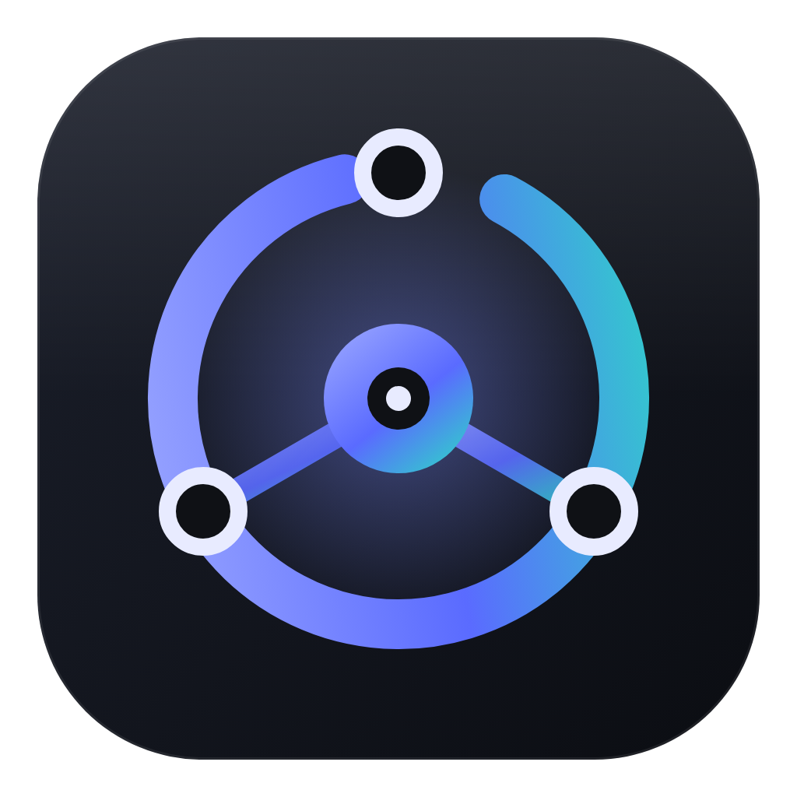

<p align="center"></p>

# OmniRoute Desktop

OmniRoute(OpenAI 호환 엔드포인트) URL과 API Key만 넣으면 Claude Desktop / Codex 앱처럼 동작하는 **코딩 에이전트 데스크톱 앱** (Electron).
OmniRoute용으로 만들었지만 OpenAI 호환 `/v1/chat/completions` 엔드포인트라면 어디든 연결할 수 있습니다.

## 다운로드

[Releases](https://github.com/bssm-oss/OmniRoute-Desktop/releases/latest)에서 받으세요.

- `OmniRoute-Desktop-Setup-<버전>.exe`: 설치형 (권장)
- `OmniRoute-Desktop-<버전>-win-x64.zip`: 압축 해제 후 `OmniRoute Desktop.exe` 실행
- `OmniRoute-Desktop-<버전>-portable.exe`: 단일 실행 파일

> 아직 코드 서명이 되어 있지 않아 Windows SmartScreen 경고가 나올 수 있습니다("추가 정보 → 실행"). 스마트 앱 컨트롤이 켜져 있으면 차단될 수 있으니 이때는 zip 버전을 사용하세요.

## 개발 실행

```powershell
npm install
npm start          # 앱 실행
npm test           # 하네스 E2E 테스트 (mock OmniRoute 서버)
npm run smoke      # 실제 Electron 창 + computer use 자가진단 (OMNI_URL/OMNI_KEY/OMNI_MODEL 지정 시 실제 모델로 computer use 검증)
# 실제 엔드포인트 E2E: $env:OMNI_URL='https://.../v1'; $env:OMNI_KEY='sk-...'; $env:OMNI_MODEL='auto/best-coding'; npm run test:live
npm run dist:win   # Windows 포터블 exe + 압축해제 폴더 빌드 (dist/)

# 격리 테스트 (실행 중인 app/ 과 userData·single-instance 충돌 없음)
npm run build:test                      # test-build/build-<시각>/OmniRoute Desktop Test.exe (경로는 test-build/LATEST.txt)
npm run test:e2e                        # UI E2E 41개 (격리 프로필 + mock 서버, 개발 소스)
$env:E2E_EXE='latest'; npm run test:e2e # 같은 UI E2E를 최신 패키징 테스트 빌드로 실행
npm run test:mm                         # 멀티 모니터 Computer Use 검증
# 임의 프로필로 개발 실행: $env:OMNI_PROFILE='dev2'; npm start   (userData: %APPDATA%\omniroute-desktop-dev2)
```

> 프로필 격리 규칙: 패키징되지 않은 실행(`electron .`, 테스트 스크립트)은 OMNI_PROFILE이 없으면 자동으로 `dev` 프로필을 쓰므로 설치된 앱의 userData를 건드리지 않습니다(`OMNI_PROFILE=default`로만 해제). single-instance lock은 프로필별로 걸립니다. 테스트 스크립트는 자기가 띄운 PID의 프로세스 트리만 종료합니다(`scripts/safe-proc.js`). 이름으로 프로세스를 종료하지 마세요.

설정 › **Computer Use · 백그라운드 작업 표시**: 화면 조작 시 창 최소화(이후 다시 띄우거나 포커스를 가져오지 않음), 조작 시작 전 카운트다운(취소 가능), 클릭이 통과되는 "에이전트 작업 중" 배지(사용자 화면에는 보이지만 `setContentProtection(true)`로 **스크린샷/화면 캡처에서 의도적으로 제외**됩니다. 에이전트가 배지를 화면 요소로 오인하거나 그 아래를 못 보는 일을 막기 위함이며, 같은 이유로 녹화·화면 공유에도 보이지 않습니다. Windows 10 2004+ 기준이며 지원되지 않는 OS에서는 캡처에 찍힐 수 있습니다), 작업표시줄 진행 표시와 트레이 아이콘, 승인 필요/완료 시 작업표시줄 깜빡임과 데스크톱 알림. 같은 설정 창의 옵션으로, 전체 권한 모드에서도 작업 폴더 밖 경로에 접근하는 명령은 승인을 요청하게 할 수 있습니다.

첫 실행 시 설정 창에서 **OmniRoute URL**(기본 `http://localhost:20128/v1`, `/v1`은 자동 보정)과 **API Key**를 입력하고 "연결 테스트"로 모델 목록을 불러옵니다. 키는 OS 보안 저장소(safeStorage)로 암호화됩니다.

## 기능

| 영역 | 내용 |
|---|---|
| 파일 접근 | 작업 폴더 열기, 파일 트리, 내장 편집기(Ctrl+S), 드래그&드롭/붙여넣기 이미지 첨부 |
| 도구 | `read_file` `write_file` `edit_file`(diff 표시) `delete_path` `list_directory` `glob` `grep` `run_command`(실시간 출력) `fetch_url` |
| Computer Use | 화면 스크린샷 + 마우스/키보드 제어 (Windows: SendInput, macOS: `cliclick`, Linux: `xdotool`). 실행 중 앱 자동 최소화, 긴급 중지 **Ctrl+Alt+Esc** (사용 불가 시 Ctrl+Shift+F12) |
| 권한 | 매번 확인 / 워크스페이스 편집 자동 / 전체 자동, "이 대화에서 항상 허용" |

### 하네스 & 모드 (Ctrl+. 로 순환)

- **💬 Ask**: 읽기 전용 도구로 질문에 답합니다.
- **🗺 Plan**: 코드를 조사한 뒤 구현 계획을 작성합니다. 결과 아래 "구현" / "Autopilot으로 구현" 버튼이 표시됩니다.
- **🛠 Agent**: 자율 코딩 에이전트로 동작합니다.
- **🚀 Autopilot**: `task_complete`가 호출될 때까지 사용자 개입 없이 계속 진행합니다. 도중에 멈추면 자동으로 재촉하고, `ask_user`는 가정을 세워 진행하며, 도구 승인은 자동으로 처리됩니다(설정에서 변경 가능). 완료되면 데스크톱 알림을 보냅니다.
- 하네스 공통 기능: 서브에이전트(`task`: `explore`, `general-purpose`, 커스텀 에이전트, 병렬 실행), `todo_write` 할 일 패널, `ask_user` 질문 카드, 컨텍스트 자동/수동 압축(`/compact`), 429/5xx 재시도, `<think>` 및 reasoning 스트림 표시

### 실행 중 메시지 (Steer / Queue)

- 에이전트가 작업 중에도 입력창은 막히지 않습니다. **Enter = 대기열(queue)**: 현재 턴이 끝나면 순서대로 자동 실행. **Ctrl+Enter 또는 🧭 Steer 버튼 = steer**: 진행 중인 실행의 다음 도구 호출 경계에서 사용자 메시지로 주입해 방향 전환.
- 대기 중 메시지는 입력창 위 패널에 표시되며 수정(✎)·순서 변경(↑↓)·삭제(✕)·steer로 전환(🧭) 가능. 중지하면 대기열은 보존되고 "▶ 지금 실행"으로 재개.

### 기타

- 대화 검색(제목·내용), 인라인 이름 변경(✎/더블클릭), Markdown 내보내기(⤓), 라이트/다크 테마(◐), 모델 직접 입력(모델 목록의 "✎ 직접 입력…")
- 연결 상태 점: 초록 = 정상 / 노랑 = `/models` 실패(채팅은 가능할 수 있음) / 빨강 = 채팅 요청 실패
- Computer Use 멀티 모니터: 스크린샷 `display: "all"`(모든 모니터 합성, 다중 모니터일 때 기본) 또는 모니터 번호 지정, 좌표는 마지막 스크린샷 기준으로 자동 매핑

### VS Code / Claude Code 호환 확장 (🧩 확장 버튼)

| 종류 | 탐색 위치 |
|---|---|
| **스킬** (`SKILL.md`) | `.github/skills`, `.claude/skills`, `.agents/skills`, `.omniroute/skills`, `~/.omniroute/skills`, `~/.claude/skills`, `~/.copilot/skills`, 플러그인 `skills/` |
| **커스텀 에이전트** (`*.agent.md`, `tools`/`model` frontmatter) | `.github/agents`, `.claude/agents`, `~/.omniroute/agents`, 플러그인 `agents/` |
| **프롬프트 / 슬래시 커맨드** (`*.prompt.md`, `$ARGUMENTS`) | `.github/prompts`, `.claude/commands`, `~/.omniroute/prompts`, 플러그인 `commands/` |
| **지침** | `AGENTS.md`, `CLAUDE.md`, `.github/copilot-instructions.md`, `.github/instructions/*.instructions.md`(applyTo) |
| **MCP 서버** (stdio / HTTP) | `.vscode/mcp.json`, `.mcp.json`, `~/.omniroute/mcp.json`, 플러그인 `.mcp.json` |
| **훅** (`SessionStart` `UserPromptSubmit` `PreToolUse` `PostToolUse` `Stop`) | `~/.omniroute/hooks.json`, `.omniroute/hooks.json`, `.claude/settings.json`, `.github/hooks/*.json`, 플러그인 `hooks/hooks.json` |
| **플러그인** (`.claude-plugin/plugin.json`, marketplace) | 로컬 폴더, git URL, `owner/repo`, `url#subdir`로 설치. 폴더 연결과 켜기/끄기 지원 |

입력창에서 `/`를 입력하면 프롬프트, 스킬, 에이전트, 내장 명령(`/clear` `/compact` `/plan` `/autopilot` …)을 자동완성합니다.

## 구조

```
src/main.js            Electron 메인, IPC, 승인/질문 흐름, 슬래시 명령
src/agent.js           하네스 루프 (모드, autopilot, 서브에이전트, 압축, 스트리밍)
src/harness.js         하네스 도구(skill/task/todo/ask_user/task_complete), 도구 필터링
src/tools.js           파일/셸/웹 도구, 권한 판정
src/computer.js        Computer Use (스크린샷 + 입력)
src/customizations.js  스킬/에이전트/프롬프트/지침/플러그인/MCP/훅 탐색
src/mcp.js             MCP 클라이언트 (stdio, streamable HTTP)
src/hooks.js           라이프사이클 훅 실행기
src/store.js           설정(암호화 키), 대화 저장
renderer/              UI (vanilla JS, marked + DOMPurify)
```
